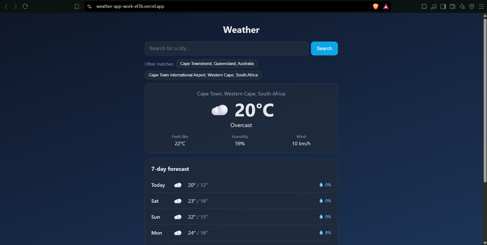

# Weather App


A weather app that finds any city in the world and shows current conditions plus a 7-day forecast. Built to practise working with third-party APIs, async state and testing in React.

[LIVE-LINK](https://weather-app-work-ef3b.vercel.app/)



## Features
- Search any city worldwide and see its current temperature, conditions, humidity and wind
- 7-day forecast with highs, lows and chance of rain
- "Other matches" suggestions when a city name is shared by several places
- Remembers your last city between visits
- Clear loading, error and "city not found" states

## Tech stack
- **Frontend:** React (Vite), deployed on Vercel
- **Data:** [Open-Meteo](https://open-meteo.com/) forecast and geocoding APIs (no API key required)
- **Testing:** Vitest and React Testing Library, run automatically with GitHub Actions

## How it works
Searching calls the Open-Meteo geocoding API to turn a city name into coordinates. Those coordinates are then used to request the forecast. Each forecast request can be cancelled with an `AbortController`, so a slow response for an old search can never overwrite a newer one. The last selected city is stored in `localStorage`.

## Tests
The tests mock the network, so they run fast and never depend on the real API. They cover the loading state, a successful search, a city that isn't found, a failing weather service and restoring the saved city.

```
npm test
```

## Running locally
```
git clone https://github.com/cayden10may-ops/weather-app.git
cd weather-app
npm install
npm run dev
```

## What I learned
- Calling and combining two REST APIs, and handling their loading and error states
- Preventing race conditions by cancelling stale requests
- Writing component tests with mocked network calls
- Setting up CI with GitHub Actions and deploying with Vercel

Weather data by [Open-Meteo.com](https://open-meteo.com/).